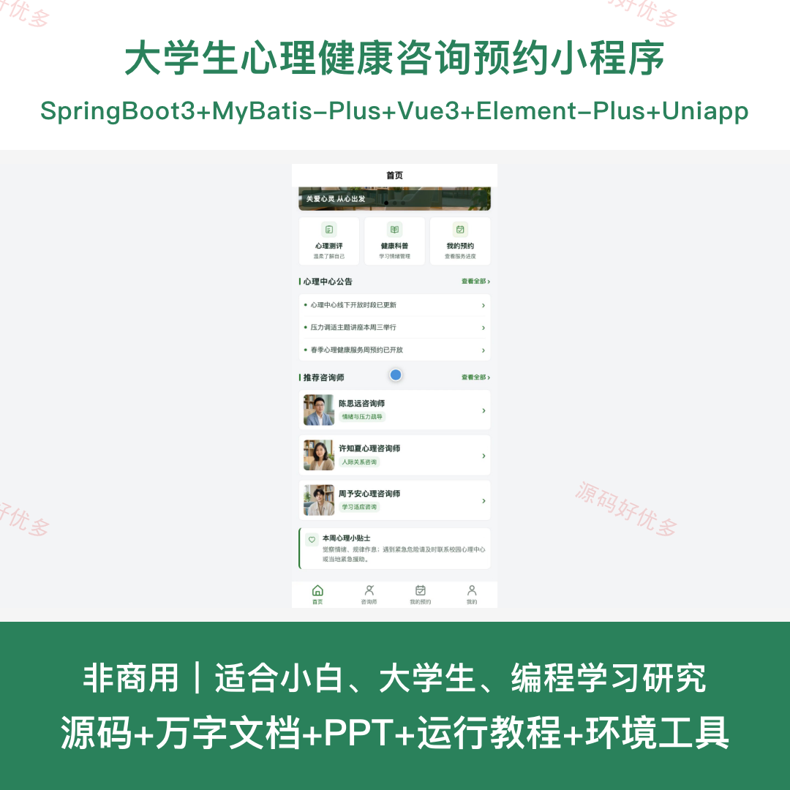
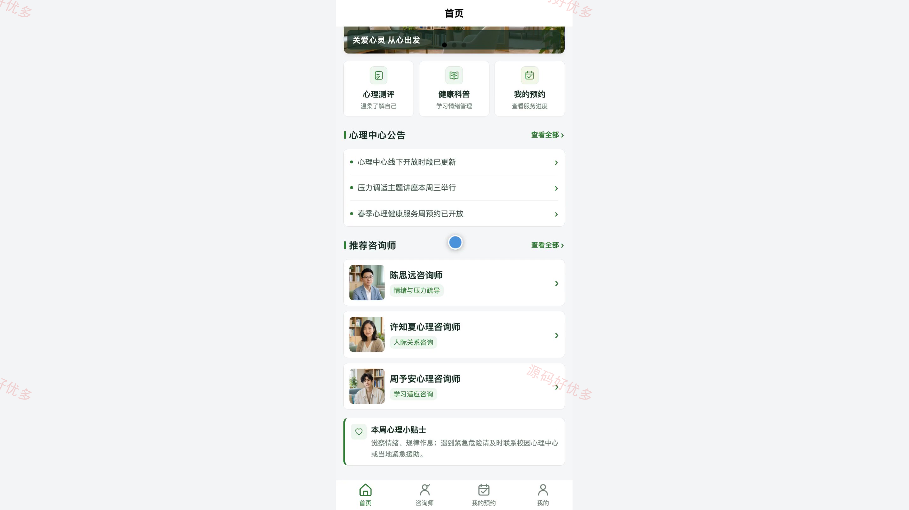
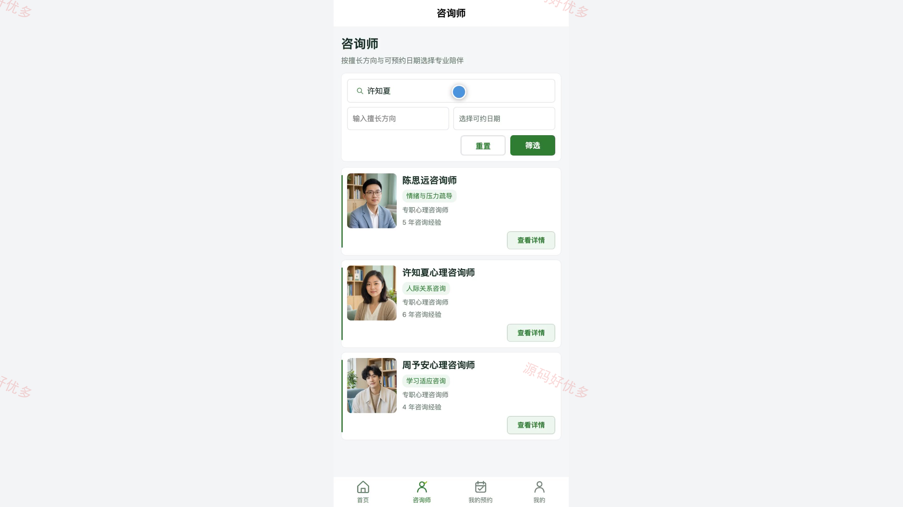
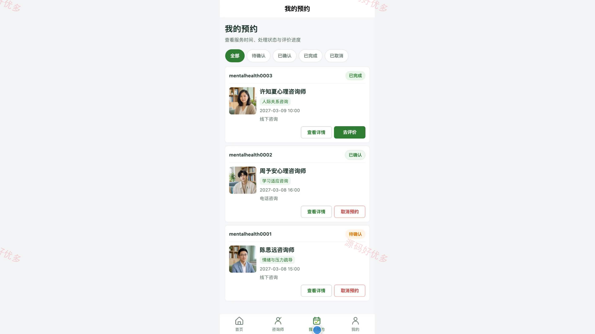
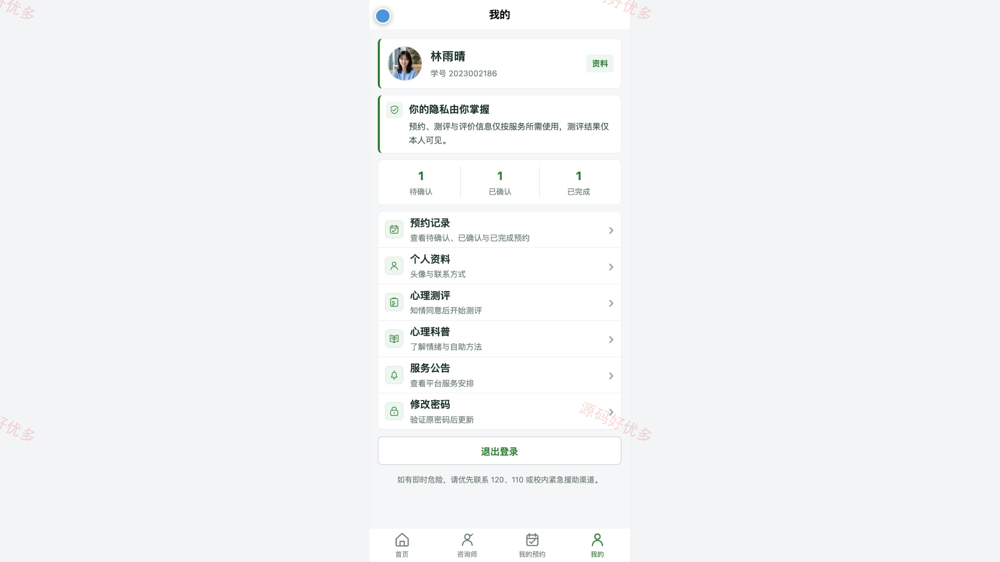
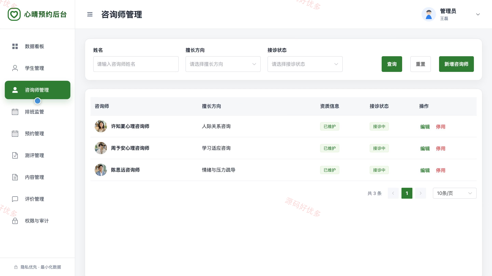
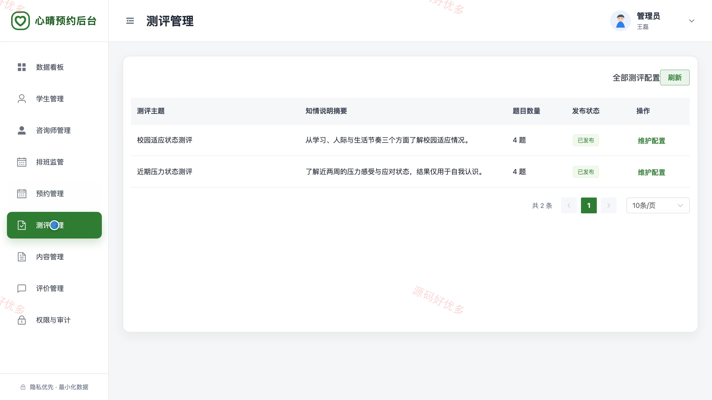
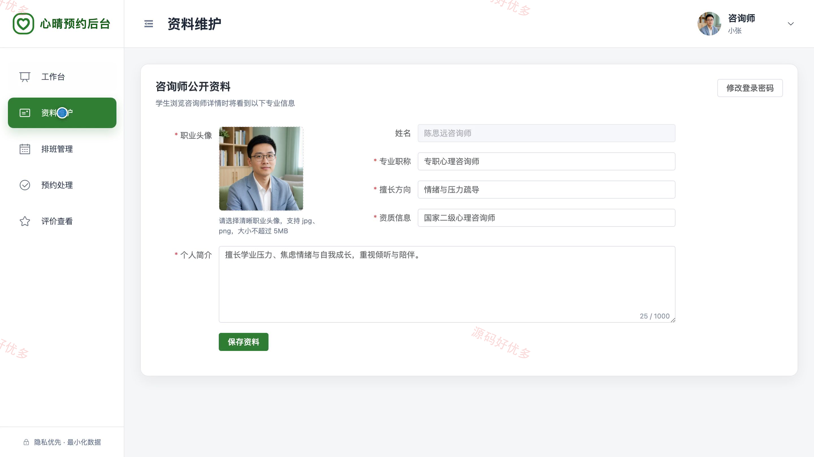
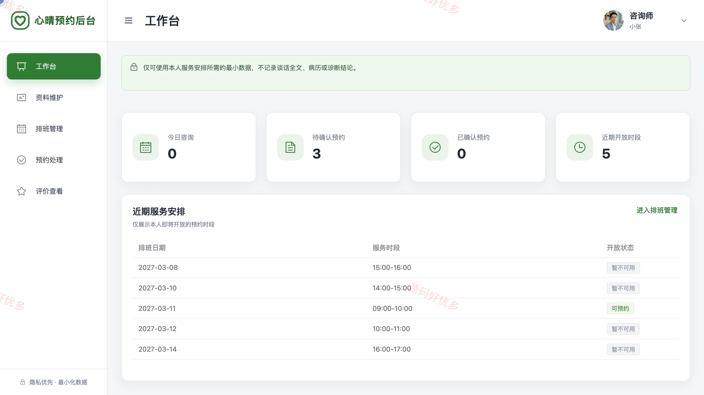

# bs110B
bs110B大学生心理健康咨询系统
## 源码问题查看主页咨询

### 一、关键词
心理咨询预约、咨询师排班、心理测评、健康科普、匿名评价、隐私审计

### 二、作品包含
源码+数据库+万字设计文档+PPT+全套环境和工具资源+本地部署教程

### 三、项目技术
前端技术： Html、Css、Js、Vue3.4、Element-Plus、uniapp
后端技术：Java、SpringBoot3.2.0、MyBatis-Plus

### 四、运行环境要求
开发工具：IDEA/eclipse + VSCODE + HBuilder X + 微信开发者工具

数据库：MySQL5.7+（共15张表）

数据库管理工具：Navicat10以上版本

环境配置软件： JDK17 + Maven3.6

前端Nodejs：20

浏览器：谷歌浏览器

### 五、项目介绍
项目编号：bs110B

面向高校心理健康服务场景，学生可通过小程序浏览咨询师与可预约时段并提交预约，完成心理测评和健康科普阅读；咨询师在管理端维护个人排班并处理本人预约，管理员负责账号、排班、预约、测评内容和隐私审计等后台管理。

角色：学生、咨询师、管理员

学生功能：学号注册登录与个人资料维护、心理中心公告与推荐咨询师浏览、咨询师筛选详情与可预约时段查看、咨询预约提交状态查看与允许状态取消、完成咨询后的匿名脱敏评价、知情同意后的心理测评与私密分级结果、心理健康科普文章浏览、联系方式维护与密码修改。

咨询师功能：个人工作台与本人预约概览、个人资料资质和头像维护、可预约日期时段排班与暂停、本人预约确认拒绝和原因填写、到访结案与最小化后续建议、本人服务匿名脱敏评价查看、预约数据范围与最小化记录告知。

管理员功能：脱敏汇总数据看板与近期趋势、学生账号必要资料查询与启停、咨询师账号资料资质接诊状态管理、咨询师排班与时段占用监管、按咨询师时间状态监管预约流程、测评题目选项计分区间援助指引管理、科普文章服务公告首页轮播内容管理、匿名评价审核与权限审计。

### 六、运行截图

